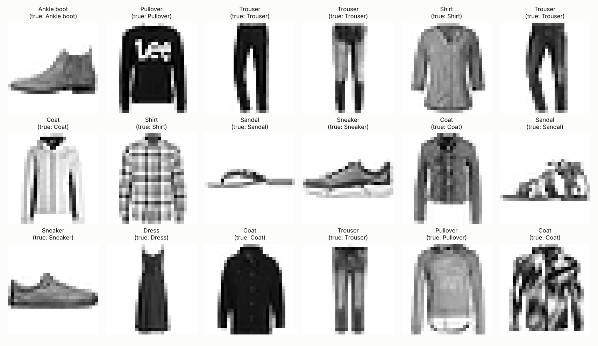
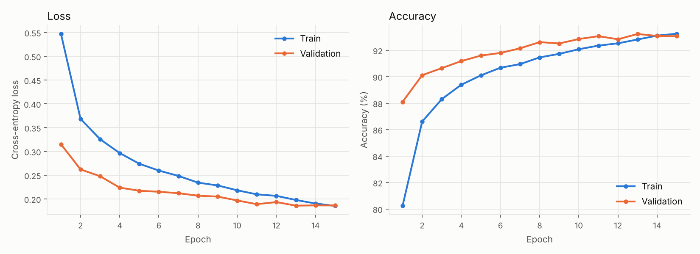
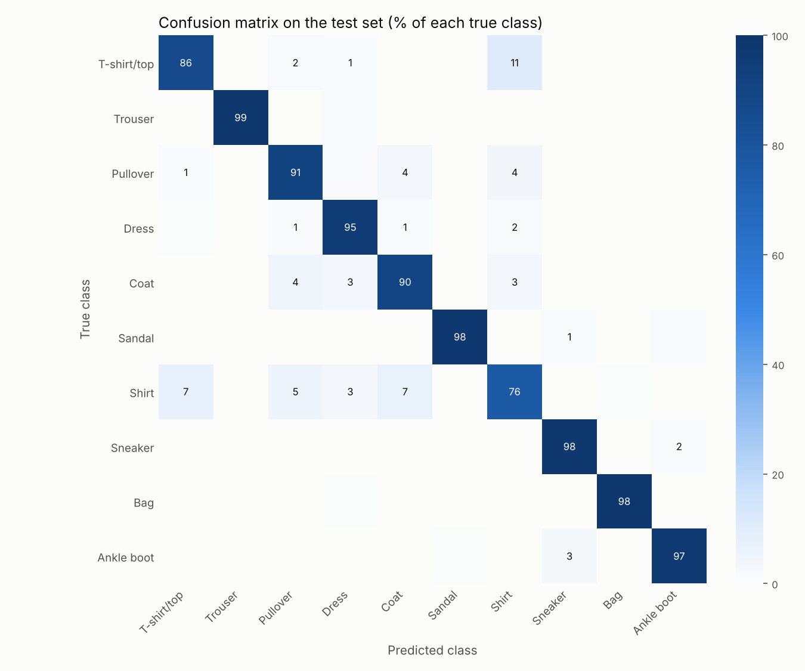

# Fashion-MNIST Image Classifier with a CNN in PyTorch


[](https://colab.research.google.com/github/Javid-stat/Image-Classification/blob/main/notebooks/train_colab.ipynb)

A convolutional neural network (CNN), built from scratch in PyTorch, that classifies
28×28 grayscale images of clothing into 10 categories. It reaches
**92.82% accuracy on the 10,000-image test set** with under half a million parameters.

This is my first neural network project. The goal was to learn the full deep-learning
workflow end to end: data preprocessing, designing a model as an `nn.Module`, writing the
training loop by hand, validating, saving the model, and evaluating it honestly on held-out data.


*The model's predictions on the first 18 images of the test set.*

---

## Results

| Metric | Value |
|---|---|
| **Test accuracy** | **92.82%** |
| Test loss (cross-entropy) | 0.202 |
| Best validation accuracy | 93.23% (epoch 13 of 15) |
| Trainable parameters | 468,202 |
| Training time | 26 min on a 2-core CPU (a Colab T4 GPU is much faster) |

The model was selected by **validation** accuracy, and the test set was used only once, at the
very end, so the test accuracy is an unbiased estimate of performance on new images.

### Learning curves



Validation accuracy is *higher* than training accuracy for most of training. That is expected, not a bug: dropout is switched on while training (making the training task harder) and off during validation, and the training accuracy is averaged over an epoch while the weights are still improving. The two curves meet around the last epochs, and validation loss flattens out after roughly epoch 13, which is why that epoch's weights were kept.

### Accuracy per class

| Class | Accuracy | | Class | Accuracy |
|---|---|---|---|---|
| T-shirt/top | 86.0% | | Sandal | 97.8% |
| Trouser | 98.7% | | Shirt | 76.2% |
| Pullover | 90.7% | | Sneaker | 98.2% |
| Dress | 95.4% | | Bag | 98.5% |
| Coat | 89.7% | | Ankle boot | 97.0% |



The model is strongest on classes with distinctive shapes: trousers, bags, sneakers, sandals and ankle boots all score 97–99%. **Shirt** is the hardest class (76.2%): it is mostly confused with T-shirt/top, coat and pullover, which look very similar at 28×28 pixels. Footwear errors stay within footwear (sneaker ↔ ankle boot).

---

## Dataset

[Fashion-MNIST](https://github.com/zalandoresearch/fashion-mnist) by Zalando Research:
70,000 grayscale images (28×28 pixels) of clothing in 10 balanced classes. It is a harder
drop-in replacement for the classic MNIST digits.

| Split | Images | Used for |
|---|---|---|
| Train | 54,000 | learning the weights |
| Validation | 6,000 (10% of the official training set) | choosing the best epoch |
| Test | 10,000 (official test set) | the final, one-time evaluation |

The dataset is downloaded automatically by `torchvision` the first time you run the code,
into `data/` (which is git-ignored).

**Preprocessing:** each image is converted to a tensor with values in [0, 1] and then
normalized with the training-set mean (0.2860) and standard deviation (0.3530), so inputs
have roughly zero mean and unit variance. This makes optimization faster and more stable.

---

## Model architecture

```
Input [1 × 28 × 28]
│
├── ConvBlock 1 ──────────────────────────────────────────── [32 × 14 × 14]
│     Conv 3×3 (1→32) → BatchNorm → ReLU
│     Conv 3×3 (32→32) → BatchNorm → ReLU
│     MaxPool 2×2 → Dropout2d(0.25)
│
├── ConvBlock 2 ──────────────────────────────────────────── [64 × 7 × 7]
│     Conv 3×3 (32→64) → BatchNorm → ReLU
│     Conv 3×3 (64→64) → BatchNorm → ReLU
│     MaxPool 2×2 → Dropout2d(0.25)
│
├── Flatten ──────────────────────────────────────────────── [3136]
├── Linear (3136→128) → ReLU → Dropout(0.5) ──────────────── [128]
└── Linear (128→10) ──────────────────────────────────────── [10 class scores]
```

| Part | Parameters |
|---|---|
| ConvBlock 1 | 9,696 |
| ConvBlock 2 | 55,680 |
| Linear 3136→128 | 401,536 |
| Linear 128→10 | 1,290 |
| **Total** | **468,202** |

**Why these layers?**

- **Convolutions (3×3)** learn small local patterns such as edges and textures. The second
  block combines them into larger shapes such as collars, sleeves and soles. Two stacked 3×3
  convolutions cover a 5×5 area with fewer weights than one 5×5 convolution.
- **Batch normalization** keeps each layer's activations on a stable scale, which speeds up
  and stabilizes training.
- **ReLU** adds the non-linearity that lets the network learn more than a linear function.
- **Max pooling** halves the image size, cutting computation and making features less
  sensitive to small shifts in position.
- **Dropout** randomly switches off units during training so the model cannot rely on any
  single feature, which reduces overfitting.
- **Fully connected layers** combine features from the whole image into a final decision.
  The last layer outputs raw scores (logits); `CrossEntropyLoss` applies the softmax.

**Training setup:** Adam optimizer (learning rate 1e-3, weight decay 1e-4), cross-entropy
loss, batch size 128, 15 epochs, fixed random seed (42).

---

## Project structure

```
Image-Classification/
├── data/                     # Fashion-MNIST is downloaded here (git-ignored)
├── models/
│   └── fashion_cnn.pth       # trained weights (best validation epoch)
├── notebooks/
│   └── train_colab.ipynb     # run everything on a free Colab GPU
├── results/
│   ├── history.json          # loss and accuracy per epoch
│   ├── results.json          # test accuracy, per-class accuracy
│   ├── training_curves.png
│   ├── confusion_matrix.png
│   └── sample_predictions.png
├── src/
│   ├── config.py             # all paths and hyperparameters in one place
│   ├── data.py               # transforms, train/val/test DataLoaders
│   ├── model.py              # the CNN (nn.Module)
│   ├── engine.py             # train_one_epoch() and evaluate()
│   ├── train.py              # training script: trains and saves the best model
│   ├── evaluate.py           # evaluation script: test accuracy and plots
│   └── utils.py              # seeding, device, saving/loading, plotting
├── .gitignore
├── requirements.txt
└── README.md
```

---

## Getting started

### 1. Clone the repository

```bash
git clone https://github.com/Javid-stat/Image-Classification.git
cd Image-Classification
```

### 2. Create a virtual environment and install dependencies

**Windows (PowerShell):**

```powershell
python -m venv .venv
.venv\Scripts\Activate.ps1
pip install -r requirements.txt
```

**macOS / Linux:**

```bash
python3 -m venv .venv
source .venv/bin/activate
pip install -r requirements.txt
```

> To train on an NVIDIA GPU locally, install the CUDA build of PyTorch from
> [pytorch.org](https://pytorch.org/get-started/locally/) first. Otherwise the CPU build is
> installed, which works fine for this project.

### 3. Train the model

Run every command from the repository root:

```bash
python -m src.train
```

This downloads the data (first run only), trains for 15 epochs, prints the loss and
accuracy after each epoch, and saves the best model to `models/fashion_cnn.pth` plus the
learning curves to `results/`.

### 4. Evaluate on the test set

```bash
python -m src.evaluate
```

This prints the test accuracy and per-class accuracy, and saves `results/results.json`,
`results/confusion_matrix.png` and `results/sample_predictions.png`.

The trained model is included in the repository, so you can run this step without training.

### Run on Google Colab instead

Click the **Open in Colab** badge at the top, choose `Runtime → Change runtime type → T4 GPU`,
and run all cells. Training takes a couple of minutes on the GPU.

### Change the settings

All hyperparameters (epochs, batch size, learning rate, ...) live in `src/config.py`.

---

## Possible improvements

- **Data augmentation** (random horizontal flips, small shifts) to reduce overfitting
- **Learning-rate scheduling** (e.g. `ReduceLROnPlateau` or cosine annealing)
- **Deeper architectures** with residual connections (ResNet-style)
- **Transfer to a harder dataset** such as CIFAR-10 (colour images)

## How this was built

This project was built together with [Claude](https://claude.ai) (Anthropic) as an AI pair
programmer, and the commit history shows both of us as co-authors.

- **Me:** chose the project goal, the dataset (Fashion-MNIST), the scope (scripts plus plots,
  runnable both locally on Windows and on Colab) and the repository layout requirements;
  reviewed the result and published it.
- **Claude:** wrote the code, comments and README, ran the training and evaluation, and
  produced the plots and results shown above.

I used the project to learn how a PyTorch CNN fits together end to end, from the data
pipeline to the training loop to honest evaluation on a held-out test set.

## Acknowledgements

Fashion-MNIST dataset © Zalando Research, released under the MIT License.
